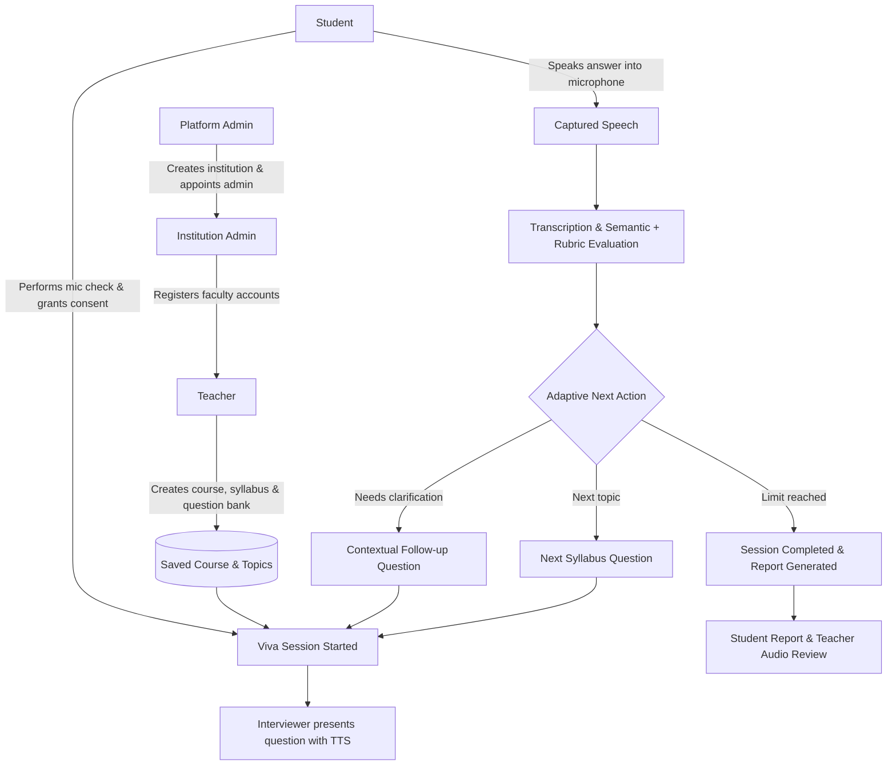

# Dhadhor-AI (AI-Based Viva Voce System)


**Syllabus-driven oral examination and practice platform with adaptive, AI-supported questioning, answer feedback, and multi-institutional academic administration.**


Dhadhor-AI is an autonomous viva voce examination system designed for educational institutions. It provides dedicated workspaces for **Platform Administrators**, **Institution Administrators**, **Teachers**, and **Students**. Institutions manage their faculty, teachers configure syllabus-grounded interview defaults and question banks, and students undergo voice-interactive oral examinations evaluated with dual semantic-embedding similarity and AI rubric criteria.


The application provides automated practice evaluation and scoring feedback for review. It serves as an assistive evaluation platform and is not a substitute for a teacher's final academic judgment.


---


## Contents


- [User Roles & Workspaces](#user-roles--workspaces)

- [Key Features](#key-features)

- [How an Interview Works](#how-an-interview-works)

- [Architecture & Tech Stack](#architecture--tech-stack)

- [Project Layout](#project-layout)

- [Prerequisites](#prerequisites)

- [Local Setup & Startup](#local-setup--startup)

- [Configuration & Environment Variables](#configuration--environment-variables)

- [API Overview](#api-overview)

- [Data Model & Database Migrations](#data-model--database-migrations)

- [Testing & Quality Checks](#testing--quality-checks)

- [Security & Production Hardening](#security--production-hardening)

- [Troubleshooting](#troubleshooting)


---


## User Roles & Workspaces


The platform enforces strict role-based access control and tenant isolation across four distinct roles:


1. **Platform Administrator (`admin`)**:

   - Accesses the Platform Admin Workspace at `#/admin`.

   - Creates institutions with unique names and short codes.

   - Appoints and provisions institution administrators for colleges and universities.

   - Does not have unrestricted access to private student assessment records.


2. **Institution Administrator (`institution_admin`)**:

   - Accesses the Institution Workspace at `#/institution`.

   - Views their institution profile and public metadata.

   - Registers faculty/teacher accounts automatically bound to their institution.

   - Searches and filters their institution's faculty directory.

   - Strictly isolated: Institution admins cannot access or view data from other institutions.


3. **Teacher (`teacher`)**:

   - Accesses the Teacher Workspace at `#/teacher` and Question Bank at `#/questions`.

   - Creates and manages courses, syllabi, topics, and interview difficulty configurations.

   - Uploads syllabus documents and maintains approved topic questions.

   - Reviews student viva sessions, inspects per-answer scores/rubrics, and plays back consented student audio answers.

   - Overrides scores with written justification and exports session reports to CSV.


4. **Student / Candidate (`student`)**:

   - Accesses the Student Dashboard at `#/`.

   - Self-registers, browses enrolled courses, and initiates practice viva sessions.

   - Undergoes a pre-viva microphone check before commencing the examination.

   - Speaks answers into the browser; answers are transcribed, evaluated, and scored in real-time.

   - Reviews detailed feedback reports with rubric breakdowns and score tracks.


---


## Key Features


### Multi-Tenant Institutional Management

- **Platform Admin Dashboard**: Register institutions and appoint institution administrators.

- **Institution Faculty Directory**: Searchable list of registered faculty members with instant client validation and duplicate conflict handling.

- **Tenant Isolation**: Backend middleware ensures users can never access courses, topics, or faculty from outside their designated scope.


### Pre-Viva Hardware & Consent Checks

- **Pre-Viva Microphone Check**: Verifies browser audio permission and stream acquisition with a live volume-meter feedback indicator before viva launch. Microphone tracks are cleanly stopped immediately upon completion or unmount.

- **Granular Consent**: Explicit opt-in for audio recording, transcript storage, and camera cue analysis.

- **Privacy Controls**: Students can delete all stored audio recordings at any time (`DELETE /api/users/{user_id}/audio`).


### Syllabus Analysis & Adaptive Oral Examination

- **Syllabus Topic Extraction**: Paste full course syllabus; Groq extracts structured modules, subtopics, and key concepts.

- **Dual-Model Scoring**: Weighted fusion of 40% semantic embedding similarity (`all-MiniLM-L6-v2`) and 60% LLM rubric evaluation (correctness, completeness, clarity).

- **Adaptive Cross-Questioning**: Context-aware follow-up questions generated dynamically when a student provides an incomplete or ambiguous response.

- **Teacher Audio Playback**: Direct authenticated streaming of candidate audio recordings (`GET /api/viva/sessions/{id}/answers/{aid}/audio`) restricted to course-owning teachers.


### Custom Viva Builder & Question Bank (P2.10)

- **Teacher Question Repository**: Create, edit, and organize oral questions by course, topic, and difficulty with custom evaluation criteria and rubrics.

- **Bulk CSV Ingestion**: Import dozens of questions at once via standard CSV with header validation and format error tracking (`/api/questions/import-csv`).

- **Custom Assessment Builder**: Configure custom oral examinations with selected topic pools, duration limits, question quotas, and draft/published lifecycle.


### Assessment Assignment, Scheduling & Deadlines (P2.11)

- **Teacher Assignment Workflow**: Schedule published custom assessments for classes or specific cohorts with optional start dates, strict deadlines, and attempt limits (`/api/assignments`).

- **Student Examination Experience**: Dedicated assignments tracker with clear status badges (`Available Now`, `Scheduled`, `Submitted`, `Overdue`), scheduling enforcement, and one-click assessment launching (`/api/student/assignments`).

- **Submission & Score Monitoring**: Detailed instructor submissions view with student progress metrics, completed scores, and direct links to session reviews.


### Detailed Performance Reports & PDF Export (P2.12)

- **Student Performance Insights**: Overall performance metrics, dimension tracks (correctness, completeness, clarity), topic mastery breakdown (Strengths, Developing, Needs Focus), score history trends, recent attempts, personalized coaching recommendations, and downloadable PDF reports (/api/reports/student/me, /api/reports/student/me/pdf).

- **Teacher Class & Cohort Analytics**: Scoped class aggregate analytics with date range (rom_date, 	o_date), course, and topic filters. Score distribution bar across mastery tiers (Mastery, Proficient, Developing, Attention Required), class-wide weak topics, individual student drilldown modal, and class summary PDF export (/api/reports/teacher/class, /api/reports/teacher/class/pdf).

- **Course-Scoped Student Drilldown**: Teachers can inspect student performance reports and download PDFs strictly scoped to shared courses (/api/reports/teacher/student/{id}, /api/reports/teacher/student/{id}/pdf) with 403 Forbidden enforcement for unshared students.

- **Robust CSV Data Export**: Multi-filter CSV export (course_id, student_id, 	opic_id, date range) with RFC 4180 standard escaping for special characters, commas, and newlines (/api/reports/export).

- **Clean PDF Generation Engine**: High-performance A4 vector PDF report generation with branding headers, KPI summary cards, structured metric tables, and automatic page breaks powered by PyMuPDF.


### Adaptive AI Viva Engine (P2.13)

- **Dynamic Question Selection**: Question choice continuously adapts to demonstrated performance in real time; strong answers escalate difficulty while struggles select foundational concept questions.

- **Topic-Aware Prioritization**: Weak and developing topics identified from historical and session evaluations are prioritized, while avoiding topic fixation and periodically checking retention on strong topics.

- **Intra- & Cross-Session Deduplication**: Guarantees zero duplicate questions within a viva session and prioritizes unattempted questions across past sessions when sufficient alternatives exist.

- **Adaptive Session Summaries**: Generates a comprehensive post-viva learning summary (`/api/viva/sessions/{id}/adaptive-summary`) detailing topics practiced, difficulty progression, demonstrated improvements, areas needing attention, and suggested next practice topics.

- **Teacher Class Analytics & Scoping**: Distinguishes between teacher-assigned assessment submissions and self-directed adaptive practice in class performance reports, tracking difficulty progression distributions and class-level teaching focus areas.

- **Assessment Safeguards**: Custom assessments and scheduled assignments remain completely deterministic, strictly using teacher-specified question sets and deadlines without alteration.


### Humanized AI Viva Experience (P2.14)

- **Natural Personalized Greetings**: Context-aware greetings on the student dashboard dynamically rotate based on time of day, student familiarity (first-time vs. returning practice), and student first name (`getStudentDashboardGreeting`).

- **Human-Like Viva Openings**: Warm introductory greetings spoken aloud and presented prior to the first question (e.g., *"Take a breath, relax, and answer in your own words"*), putting students at ease without introducing extra UI delays.

- **Context-Aware Transitions**: Seamless conversational bridges between questions reflecting difficulty shifts (stepping up after strong answers, stepping down to foundational concepts after struggles, transitioning between topics, or revisiting earlier themes).

- **Empathetic, Truthful Answer Acknowledgements**: Conversational feedback strictly grounded in real evaluation scores without artificial praise—celebrating strong insights (>= 0.75), acknowledging solid partial efforts (0.50–0.74), and providing growth-oriented encouragement for developing answers (< 0.50).

- **Warm Session Closings**: End-of-viva wrap-up messages personalized with student name that celebrate mastery or encourage steady practice on the feedback report.

- **Non-Stigmatizing Tone**: Replaces anxiety-inducing phrasing with growth-oriented language ("learning opportunity", "areas to polish", "foundational review") while preserving underlying evaluation accuracy and teacher metrics.


### Curriculum Document Ingestion & RAG Indexing

- **Teacher Material Ingestion**: Direct upload of syllabus textbooks, lecture notes, and reference files (PDF, TXT, Markdown, CSV, JSON up to 25MB) directly bound to course topics.

- **Automated FAISS Vector Indexing**: Chunks documents into semantic segments and indexes them with dense embeddings for ground-truth RAG viva questioning and evaluation.

- **Topic Document Manager**: Full document lifecycle management in the teacher dashboard (format validation, upload progress, chunk count tracking, manual re-indexing, and deletion).


---


## How an Interview Works





---


## Architecture & Tech Stack


| Component | Technology | Description |

|---|---|---|

| **Frontend** | React 18, Vite 6, Axios | Hash-routed single-page application with role guards and responsive UI |

| **Backend** | Python 3.11+, FastAPI, Uvicorn | Async REST API with dependency injection and Pydantic validation |

| **Database** | SQLAlchemy 2.0 Async, SQLite / PostgreSQL | Async ORM; SQLite for dev, PostgreSQL supported for production |

| **Migrations** | Alembic | Version-controlled schema migrations |

| **LLM Provider** | Groq Python SDK (`openai/gpt-oss-120b`) | Syllabus analysis, adaptive interview orchestration, rubric evaluation |

| **Audio & Speech** | Web Speech API, MediaRecorder, Whisper | Browser captions with backend fallback (`faster-whisper` or Groq Whisper) |

| **Embeddings & RAG** | Sentence-Transformers, FAISS CPU, NumPy | Semantic similarity matching and topic material retrieval |

| **Auth & Security** | JWT Bearer Tokens, Bcrypt | Password hashing, role enforcement, ownership verification |


---


## Project Layout


```text

.

├── backend/

│   ├── alembic/              # Database migration environment and revisions

│   ├── app/

│   │   ├── api/              # API endpoints (admin, institution, auth, courses, viva, reports)

│   │   ├── llm/              # Groq provider integration and prompts

│   │   ├── models/           # SQLAlchemy database entities (User, Institution, Course, Session, etc.)

│   │   ├── schemas/          # Pydantic request/response schemas

│   │   ├── services/         # Orchestrator, evaluation, speech, documents, retrieval

│   │   ├── config.py         # Environment configuration and validation

│   │   ├── database.py       # Async engine and session factory

│   │   └── main.py           # FastAPI application and health check routes

│   ├── tests/                # Comprehensive Pytest suite (121 tests)

│   ├── pyproject.toml        # Backend configuration

│   ├── requirements.txt      # Dependency manifest

│   └── .env.example          # Backend environment template

├── frontend/

│   ├── src/

│   │   ├── api/              # Axios HTTP client

│   │   ├── components/       # MicCheck, ConsentModal, Timer, etc.

│   │   ├── hooks/            # AuthContext and useAuth

│   │   ├── pages/            # PlatformAdmin, InstitutionAdmin, Teacher, Student dashboards

│   │   └── utils/            # Pure helpers and Node unit tests (63 tests)

│   ├── package.json          # Frontend scripts and dependencies

│   ├── vite.config.js        # Vite dev server and proxy

│   └── .env.example          # Frontend environment template

├── .env.example              # Root environment template

├── dev.py                    # Dual-service startup script

└── README.md

```


---


## Prerequisites


- **Python**: 3.11 or newer.

- **Node.js**: v18 or newer (tested with v20+ / v26).

- **Groq API Key**: Obtain a free API key from the [Groq Console](https://console.groq.com/).

- **Browser**: Modern Chrome, Edge, Firefox, or Safari with microphone permissions enabled.


---


## Local Setup & Startup


### 1. Environment Setup


```powershell

# Clone the repository

git clone <repository-url>

cd Dhadhor-AI-main


# Copy configuration template

Copy-Item .env.example .env

```


Edit `.env` and configure:

- `GROQ_API_KEY`: Your Groq API key.

- `SECRET_KEY`: Generate a secure random secret (e.g. `python -c "import secrets; print(secrets.token_hex(32))"`).


### 2. Backend Setup & Migrations


```powershell

cd backend

python -m venv .venv

.\.venv\Scripts\Activate.ps1

python -m pip install --upgrade pip

python -m pip install -e ".[dev]"


# Apply database migrations

alembic upgrade head

```


Verify migration status:

```powershell

alembic current

# Output should show: c74d82f19a0e (head)

```


### 3. One-Command Demo Database Seeding (Optional)


To seed a complete, presentation-ready academic environment in one command:

```powershell

python backend/scripts/seed.py

```

This automatically initializes:

- **Apex Institute of Technology (`APEX`)**

- Demo accounts across all four workspaces:

  - **Platform Admin**: `admin@apex.edu` / `admin123` (`#/admin`)

  - **Institution Admin**: `instadmin@apex.edu` / `instadmin123` (`#/institution`)

  - **Teacher**: `teacher@apex.edu` / `teacher123` (`#/teacher`)

  - **Students**: `student@apex.edu`, `ananya@apex.edu`, `rohit@apex.edu` / `student123` (`#/`)

- Sample Courses (`CS201 Data Structures & Algorithms`, `CS301 Operating Systems`) with structured topics

- Sample Curriculum Reference Document with active FAISS vector index

- 9 Approved Question Bank entries with expected key points

- Published custom assessment & active scheduled assignment

- 3 Scored completed student viva sessions with transcripts and rubrics


### 4. Frontend Setup


In a second terminal:

```powershell

cd frontend

npm install

```


### 5. Running the Services


**Option A: Dual Startup (Recommended for Development)**

From the repository root:

```powershell

python dev.py

```


**Option B: Separate Terminals**

- Backend terminal:

  ```powershell

  cd backend

  .\.venv\Scripts\Activate.ps1

  uvicorn app.main:app --reload --host 127.0.0.1 --port 8000

  ```

- Frontend terminal:

  ```powershell

  cd frontend

  npm run dev

  ```


Open **`http://localhost:5173`** in your browser. API docs are available at **`http://127.0.0.1:8000/docs`**.


---


## Configuration & Environment Variables


| Variable | Description | Default | Required |

|---|---|---|---|

| `APP_NAME` | Application name and API title | `Dhadhor-AI` | No |

| `ENVIRONMENT` | Deployment environment (`development` / `production`) | `development` | No |

| `DEBUG` | Enable debug mode | `false` | No |

| `API_V1_STR` | REST API prefix | `/api` | No |

| `SECRET_KEY` | JWT signing secret (min 16 chars; generate secure key for prod) | Development default | **Yes in production** |

| `ACCESS_TOKEN_EXPIRE_MINUTES` | Lifetime of user access tokens | `1440` (24h) | No |

| `DATABASE_URL` | Async database connection URL | `sqlite+aiosqlite:///./viva.db` | No (SQLite default) |

| `CORS_ORIGINS` | Comma-separated allowed frontend origins | `http://localhost:5173,http://127.0.0.1:5173` | Yes in production |

| `GROQ_API_KEY` | Groq authentication key for syllabus analysis & evaluation | None | **Yes** |

| `GROQ_MODEL` | Groq chat model identifier | `openai/gpt-oss-120b` | No |

| `GROQ_TIMEOUT_SECONDS` | Timeout for Groq API calls | `45.0` | No |

| `GROQ_STT_MODEL` | Whisper model on Groq for speech-to-text fallback | `whisper-large-v3-turbo` | No |

| `WHISPER_MODEL` | Local faster-whisper model (optional) | `base` | No |

| `MAX_UPLOAD_SIZE_MB` | Maximum allowed file upload size (documents & audio) | `25` | No |

| `VITE_API_URL` | Frontend API target (in `frontend/.env`) | `http://localhost:8000` | No in dev (uses proxy) |


---


## API Overview


All routes are mounted under the `/api` prefix. Protected routes require `Authorization: Bearer <token>`.


### Platform Administration

| Method & Path | Description | Access |

|---|---|---|

| `POST /api/admin/institutions` | Create a new institution | Platform Admin (`admin`) |

| `GET /api/admin/institutions` | List all registered institutions | Platform Admin (`admin`) |

| `POST /api/admin/institutions/{id}/admins` | Appoint an institution administrator | Platform Admin (`admin`) |


### Institution Administration

| Method & Path | Description | Access |

|---|---|---|

| `GET /api/institution/profile` | View caller's institution profile and code | Institution Admin (`institution_admin`) |

| `POST /api/institution/teachers` | Register a teacher bound to caller's institution | Institution Admin (`institution_admin`) |

| `GET /api/institution/teachers` | List teachers belonging to caller's institution | Institution Admin (`institution_admin`) |


### Authentication & Profiles

| Method & Path | Description | Access |

|---|---|---|

| `POST /api/auth/register` | Student self-registration | Public |

| `POST /api/auth/login` | Authenticate and retrieve access token | Public |

| `GET /api/auth/me` | Fetch authenticated user profile & institution assignment | Authenticated |


### Courses, Topics & Questions

| Method & Path | Description | Access |

|---|---|---|

| `GET /api/courses`, `POST /api/courses` | List or create courses | Authenticated (writes: Teacher) |

| `POST /api/courses/{id}/syllabus/analyze` | Analyze course syllabus with Groq | Course Owner |

| `POST /api/courses/{id}/topics` | Add topic to course | Course Owner |

| `POST /api/topics/{id}/documents` | Upload syllabus document (max 25MB) | Course Owner |

| `GET/POST /api/questions` | Manage question bank entries | Authenticated (writes: Teacher) |


### Viva Examination & Reviews

| Method & Path | Description | Access |

|---|---|---|

| `POST /api/viva/sessions` | Start a student viva examination | Student |

| `POST /api/consent` | Record audio, transcript, or camera consent | Session Student |

| `POST /api/viva/sessions/{id}/answer` | Submit spoken answer (audio file) | Session Student |

| `POST /api/viva/sessions/{id}/next` | Advance to next viva question | Session Student |

| `POST /api/viva/sessions/{id}/finish` | Finalize session and calculate mean score | Session Student |

| `GET /api/viva/sessions/{id}/report` | Retrieve candidate performance report | Session Student / Course Teacher |

| `GET /api/teacher/sessions` | List student sessions for teacher's courses | Teacher |

| `GET /api/viva/sessions/{id}/answers/{aid}/audio` | Stream consented student answer audio | Course Teacher / Session Student |

| `DELETE /api/users/{user_id}/audio` | Delete all stored audio files and paths | Audio Owner |


### Performance Reports & Export

| Method & Path | Description | Access |

|---|---|---|

| GET /api/reports/student/me | Fetch student detailed performance report | Student |

| GET /api/reports/student/me/pdf | Download student performance report PDF | Student |

| GET /api/reports/teacher/student/{id} | Fetch student performance report scoped to teacher | Course Teacher |

| GET /api/reports/teacher/student/{id}/pdf | Download student performance report PDF scoped to teacher | Course Teacher |

| GET /api/reports/teacher/class | Fetch class aggregate performance report with filters | Teacher |

| GET /api/reports/teacher/class/pdf | Download class aggregate performance report PDF | Teacher |

| GET /api/reports/export | Download filtered viva session data CSV | Teacher |

| `GET /api/viva/sessions/{id}/adaptive-summary` | Retrieve adaptive learning summary and progression | Student / Course Teacher |


### Health Checks

| Method & Path | Description | Access |

|---|---|---|

| `GET /api/health` | Verifies database connectivity and API liveness | Public |

| `GET /api/health/ai` | Verifies Groq model availability and key validity | Public |


---


## Data Model & Database Migrations


Database entities managed by SQLAlchemy:

- **`Institution`**: Academic institution (`name`, `code`, `is_active`).

- **`User`**: Account identity (`email`, `hashed_password`, `role`, `institution_id`).

- **`Course`**: Course syllabus, modules, topic mappings, interview defaults.

- **`Topic`**: Modular learning unit linked to a course.

- **`Document`**: Uploaded curriculum reference documents and embeddings.

- **`Question`**: Approved or generated questions with expected key points and difficulty.

- **`VivaSession`**: Examination session tracking question index, limits, and final score.

- **`Answer`**: Audio path, transcript, embeddings score, LLM rubric breakdown, and latency.

- **`Consent`**: Audit trail for audio retention, transcript usage, and camera cues.


Apply migrations:

```powershell

cd backend

alembic upgrade head

```


---


## Testing & Quality Checks


### Backend Test Suite (Pytest)

Executes all 125 integration and unit tests covering authentication, multi-tenancy, cross-role security, viva lifecycle, audio streaming, and upload limits:

```powershell

cd backend

pytest

```


Run specific test modules:

```powershell

pytest tests/test_e2e_workflows.py        # End-to-end multi-role lifecycle tests

pytest tests/test_institutions.py         # Institution & Platform admin tests

pytest tests/test_production_readiness.py # Upload limits and cleanup tests

pytest tests/test_performance_reports.py  # P2.12 Performance reports & PDF export tests

pytest tests/test_adaptive_viva.py        # P2.13 Adaptive AI Viva Engine tests

pytest tests/test_conversational_viva.py   # P2.14 Humanized conversational viva tests

```


### Frontend Unit Tests (Node Built-In Test Runner)

Executes all 80 pure unit tests covering input validation, score formatters, date formatters, mic check state transitions, and search filters:

```powershell

node --test frontend/src/utils/*.test.js

```


### Frontend Production Build (Vite)

Verifies production bundle generation with zero warnings or errors:

```powershell

cd frontend

npm run build

```


---


## Security & Production Hardening


1. **Secret Key Entropy**:

   - `SECRET_KEY` must be at least 16 characters. A critical warning is logged on startup if the default development secret is detected in production.

   - Generate production secrets using: `python -c "import secrets; print(secrets.token_hex(32))"`.

2. **File Upload Protection**:

   - Document and audio uploads are capped at 25MB (`MAX_UPLOAD_SIZE_MB`).

   - Oversized documents return `400 Bad Request`; oversized audio files return `413 Payload Too Large`.

3. **Audio File Cleanup**:

   - When a user deletes their recordings, both raw `.webm` audio and any temporary converted `.wav` files are permanently unlinked from disk.

4. **Tenant Isolation**:

   - Institution IDs are derived strictly from server-side JWT claims. Request payloads cannot assign or override institution boundaries.

5. **No Password Exposure**:

   - Password hashes are stored using bcrypt; API schemas strictly exclude password hashes from all serialization responses.


---


## Troubleshooting


- **Database Connection Error**:

  Run `GET http://127.0.0.1:8000/api/health`. If the database is unreachable, verify `DATABASE_URL` in `.env` and run `alembic upgrade head` from `backend\`.

- **Groq AI Error**:

  Run `GET http://127.0.0.1:8000/api/health/ai`. If HTTP 503 is returned, ensure `GROQ_API_KEY` is set correctly in `.env` without surrounding quotes.

- **Microphone Access Denied**:

  Ensure browser permissions are granted for `http://localhost:5173`. Media access requires `localhost` or HTTPS.

- **CORS Error**:

  If accessing the backend from an external IP or domain, add the origin to `CORS_ORIGINS` in `.env`.

- **Frontend Test Runner**:

  Run `node --test frontend/src/utils/*.test.js` from the repository root using Node.js 18+.
